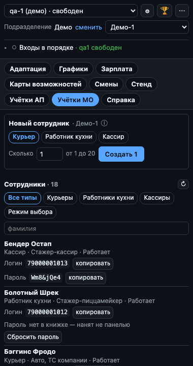
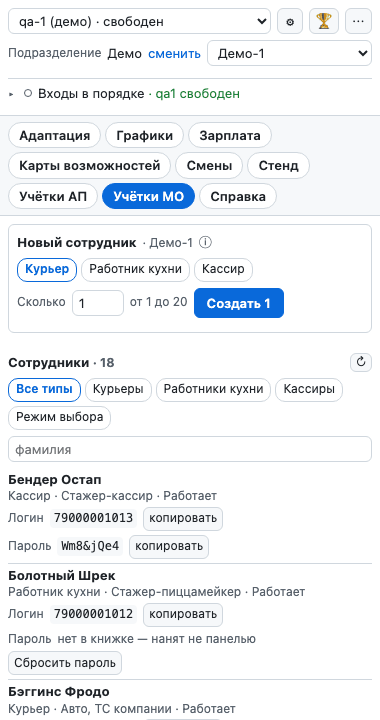
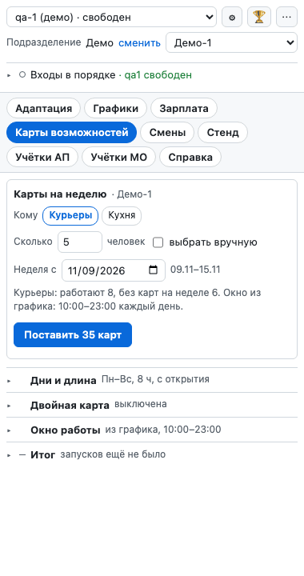
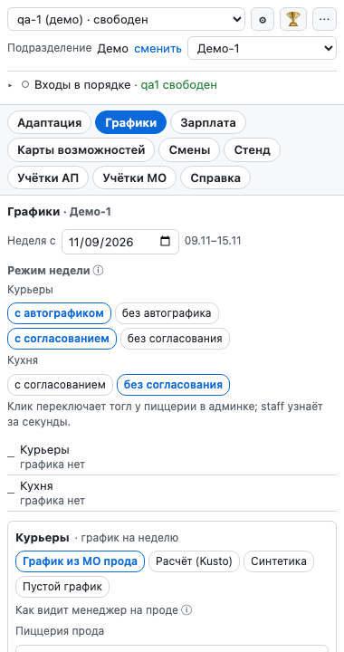
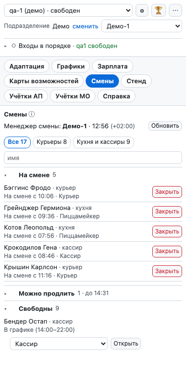
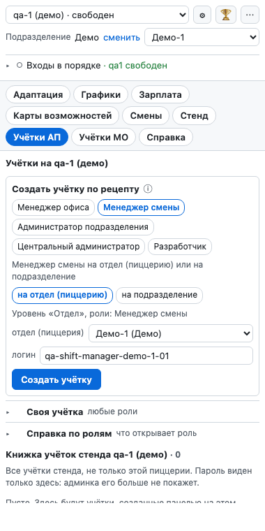
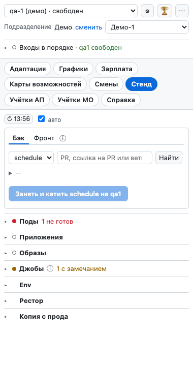
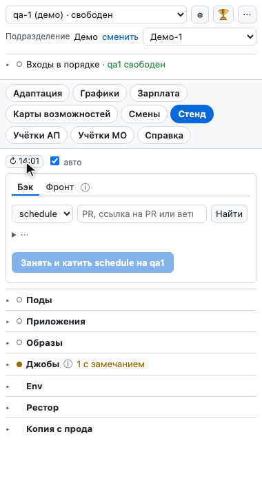
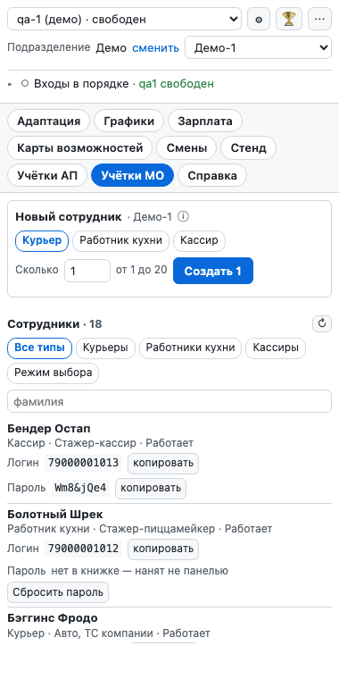
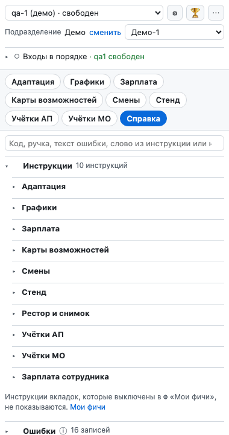

# Stand Kit

Расширение Chrome: пульт дев-стендов в боковой панели. Сотрудники с логином и паролем, карты возможностей,
графики в любом из шести режимов, смены, учётки, раскатка и здоровье стенда — в пару кликов. Работает под
входами самого человека, отдельных паролей не нужно. Пишет только в дев-стенды, прод — только читает.

> Это витрина для портфолио. Гифки сняты на выдуманном стенде «qa-1 (демо)»: герои мультиков, телефоны
> +7 900 000-…, придуманные сервисы schedule, core, seeder и hiring. Рабочий код и установка — в закрытом
> репозитории команды: там адреса и ручки внутренних систем.

## Зачем

Чтобы проверить задачу, сначала нужны данные: нанять курьера, выдать ему карты на неделю, рассчитать график,
открыть смену, понять, почему упал под. Раньше это несколько админок, запросы руками, база и kubectl. В панели —
вкладка и кнопка, а ошибки объяснены человеческим языком.

## Что умеет

<table>
<tr><td width="300" valign="top"></td><td valign="top">

### Учётки МО

- **«Новый сотрудник»:** 1–20 курьеров, работников кухни или кассиров через форму найма Менеджера офиса (МО).
  Логин и пароль — сразу в строке и в книжке паролей.
- В карточке: «Сбросить пароль», «Новый телефон и пароль», «Отстранить» и «Вернуть из отстранения»,
  «Уволить», логин учётки из админки.
- «Режим выбора» → «Уволить выбранных». Уволенные — в ящике «Уволенные», там «Восстановить».
- «Зарплата» в карточке: ставка, смены за два месяца, перенос смены в прошлое. Сумма — из отчёта
  «Заработная плата».

</td></tr>
<tr><td valign="top"></td><td valign="top">

### Карты возможностей

- Карты на неделю курьерам или кухне: скольким людям или «выбрать вручную», дни и длина, начало.
- «Двойная карта» — второй период в тот же день. «Окно работы» — из графика пиццерии или вручную.
- Не хватает людей — панель сама нанимает недостающих.
- Перед записью — таблица «кому что поставлю», после — «Итог».

</td></tr>
<tr><td valign="top"></td><td valign="top">

### Графики

- Неделя пиццерии: какие графики есть, какие тоглы включены и какой из шести режимов получится.
  Тоглы автографика и согласования — чипами.
- График курьеров с прода: «График из МО прода» — как видит менеджер, «Расчёт (Kusto)» — сырой расчёт
  движка. Сверху списка — пиццерии прода с расчётом на выбранную неделю.
- «Синтетика» — смены N курьерам каждый день, «Пустой график» — режим без автографика.
- «Создать график кухни»: карты сотрудникам кухни и график недели.
- «Согласование» за любого сотрудника — по дням, с комментарием; «Завершить согласование сейчас».
- «Удалить график недели» и «Очистить неделю» — вернуть неделю в «пусто».

</td></tr>
<tr><td valign="top"></td><td valign="top">

### Смены

- Открыть и закрыть смену курьеру, работнику кухни или кассиру — так же, как это делает Менеджер смены.
- «Продлить»: вернуть закрытую смену на смену до нужного времени.
- Панель сама переключает Менеджер смены на пиццерию вкладки, и в открытых вкладках тоже.

</td></tr>
<tr><td valign="top"></td><td valign="top">

### Учётки АП

- Учётка по рецепту в один клик: менеджер офиса, менеджер смены, администратор подразделения,
  центральный администратор, разработчик.
- «Своя учётка» — любые роли на уровне страны, подразделения или отдела.
- Книжка учёток с паролями и «Справка по ролям»: 28 ролей и уровни, на которых их даёт форма.

</td></tr>
<tr><td valign="top"></td><td valign="top">

### Стенд: здоровье и настройки

- «Поды»: какие не готовы, кто в CrashLoop и сколько рестартов; «логи» за 15 минут — сутки, с уровнем,
  поиском и «до рестарта»; «перезапустить».
- «Приложения», «Образы» с коммитом и сравнением с другим стендом.
- «Джобы»: расписание по МСК, «изменить расписание», «запустить через N минут», вернуть исходное.
- «Env»: секреты маской, правка ключей, пресеты, сравнение с другим стендом.
- «Рестор»: снимок своих данных стенда на компьютер до рестора и команды рестора.

</td></tr>
<tr><td valign="top"></td><td valign="top">

### Раскатка и занятость

- Бэк по PR или ветке: «Занять и катить» → пост «займу» в канал занятости стендов после «Отправить?» →
  команда боту раскатки в тред → ход и итог в журнале. Красный деплой — с причиной.
- Фронт (микрофронтенды МО и Менеджера смены) — вкладка «Фронт».
- «Освободить» отмечает пост освобождённым. Занятые сервисы — красным в шапке, все стенды — в ⚙ «Стенды».

</td></tr>
<tr><td valign="top"></td><td valign="top">

### Копия пиццерии с прода

- Пиццерия прода на стенд с теми же айди пиццерии, отдела и сотрудников: часы работы, тоглы,
  сотрудники всех должностей с учётками. Имена, телефоны и ИНН — выдуманные.
- История за 28 дней: графики, смены, заказы с курьерами и поездками, ставки, обучение, прогнозы,
  кандидаты. Сотрудники соседних пиццерий — в своих пиццериях.
- До записи — план: сколько работают, уволены, гостей.

</td></tr>
<tr><td valign="top"></td><td valign="top">

### Ошибки

- Под ошибкой любого запроса — «Что случилось»: почему и что делать. Известный баг — со ссылкой на карточку
  в трекере и её статусом.
- «Логи» стенда за ±2 минуты от ошибки.
- «Копировать для бага»: ручка, код, текст, время, стенд, пиццерия и неделя одной кнопкой.

</td></tr>
<tr><td valign="top"></td><td valign="top">

### Справка и достижения

- Инструкция по шагам к каждой вкладке, отдельно — «Зарплата сотрудника» и «Рестор и снимок».
- Поиск по ошибкам стенда, правилам системы и известным багам.
- 🏆 Сорок ачивок за дела в панели — первая зелёная раскатка, пятничный бэк после 17:00 и другие.
  Плашка всплывает на странице стенда или уведомлением системы.

</td></tr>
<tr><td valign="top"></td><td valign="top">

### Мои фичи

- ⚙ → «Мои фичи»: любую из 59 фич можно выключить. У выключенной нет ни кнопок, ни запросов.
- Точка входа в шапке пропадает, если вход больше ничему не нужен.
- Набор галочек выгружается и отдаётся коллеге.

</td></tr>
</table>

**Ещё вкладки:** «Адаптация» — прогресс курсов обучения, как его покажет МО; «Зарплата» — засев прошлых смен
и заказов для отчёта «Заработная плата»; «Найм» — план найма на месяц: создать, финализировать, сдвинуть окно,
засеять все пиццерии.

**Шапка:** стенд и его занятость, подразделение и пиццерия, логи, версия и ↻. Строка «Входы» — точки МО,
Менеджера смены, админки и помощника. Сторож раз в 5 минут перепроверяет входы и продлевает вход в МО,
а слетевший вход восстанавливает сам фоновой вкладкой.

**Клавиши:** Alt+1…9 — вкладка, Alt+0 — настройки, / — поиск, Esc — закрыть, ? — список. Работают по месту,
а не по букве: на русской раскладке так же.

## Как устроено

- **Оболочка — расширение Chrome Manifest V3.** Боковая панель с рамкой и relay запросов: у оболочки есть права
  на домены стендов и куки входов пользователя, поэтому интерфейсу не мешает CORS. Правила declarativeNetRequest
  снимают чужой `Origin` там, где сервис его не пускает. Оболочка меняется редко.
- **Интерфейс — чистый JavaScript без фреймворков,** грузится в рамку с GitHub Pages: открыл панель — уже свежая
  версия, без переустановки. Логика вынесена в чистые модули без сети и DOM, детали вида — в общий набор
  (светофор, ящик, карточка действия, подтверждение).
- **Помощник на Python** — для «Стенда», раскатки и копии с прода. Слушает только `127.0.0.1` и только Origin
  расширения, выполняет kubectl правами самого человека. Секретов в расширении нет: env с похожими на секрет
  значениями приходит маской с отпечатком. Упал — сам заводит issue с отчётом, пароли и токены вырезаны.
- **Реестр фич:** каждая кнопка и запрос описаны в одном месте — отсюда «Мои фичи» и справка.
- **Справочник ошибок:** известные ошибки стенда и баги — с причиной и тем, что делать.
- **Обновления:** оболочку и помощник — по жёлтой полосе «обновите»; оболочку обновляет кнопка в самой полосе.

## Тесты

570 тестов на встроенном `node:test` и 132 на `unittest` для помощника, прогон в GitHub Actions на каждый PR.
Тест считается готовым, когда его видели красным: сломать логику — упал, вернуть — зелёный.

Гифки этой витрины сняты Playwright на настоящем интерфейсе: ответы стенда подменены выдуманными, а текст
каждого кадра прогнан через распознавание и проверен на внутренние адреса и имена.

## Стек

JavaScript (ES-модули), Chrome Extensions Manifest V3, Python 3, kubectl, GitHub Pages, GitHub Actions,
`node:test`, Playwright, ffmpeg и gifsicle — для гифок.
