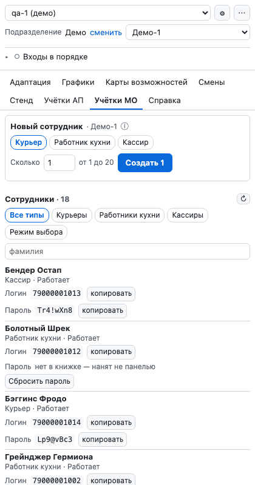
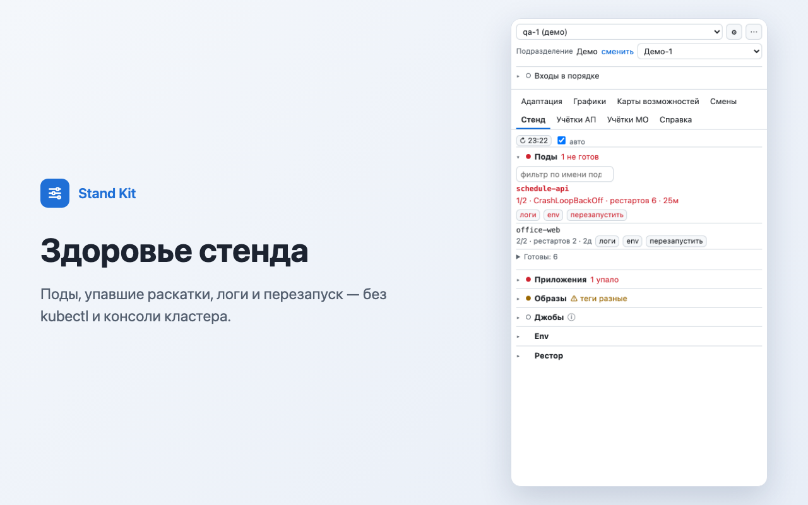
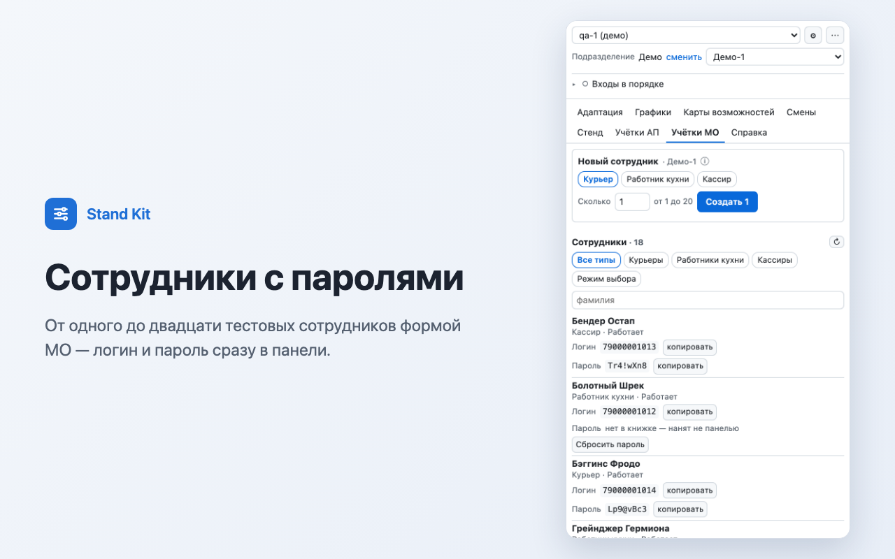
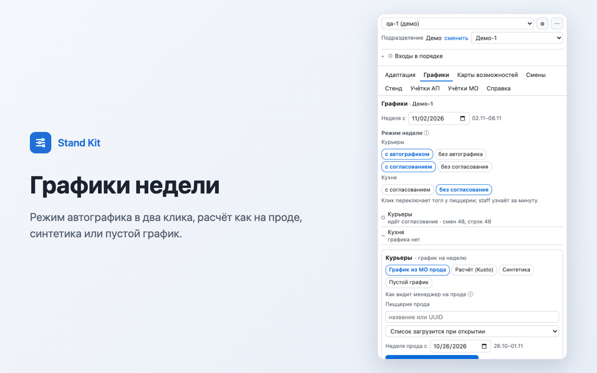
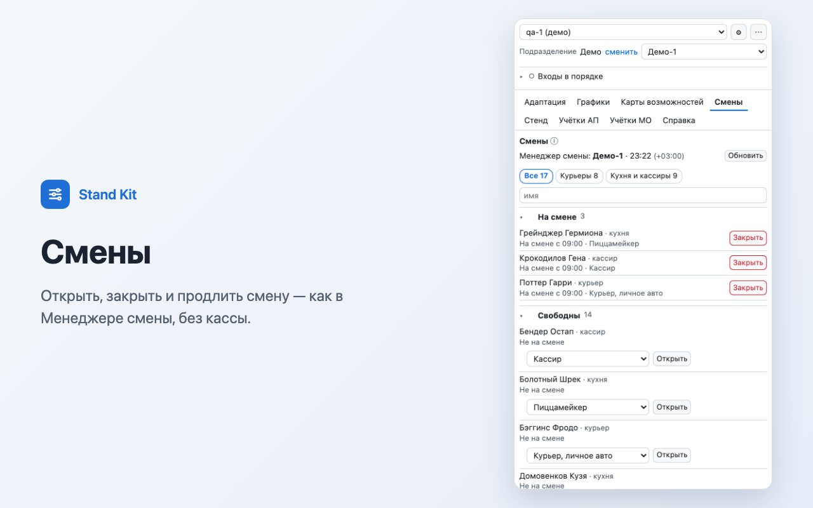
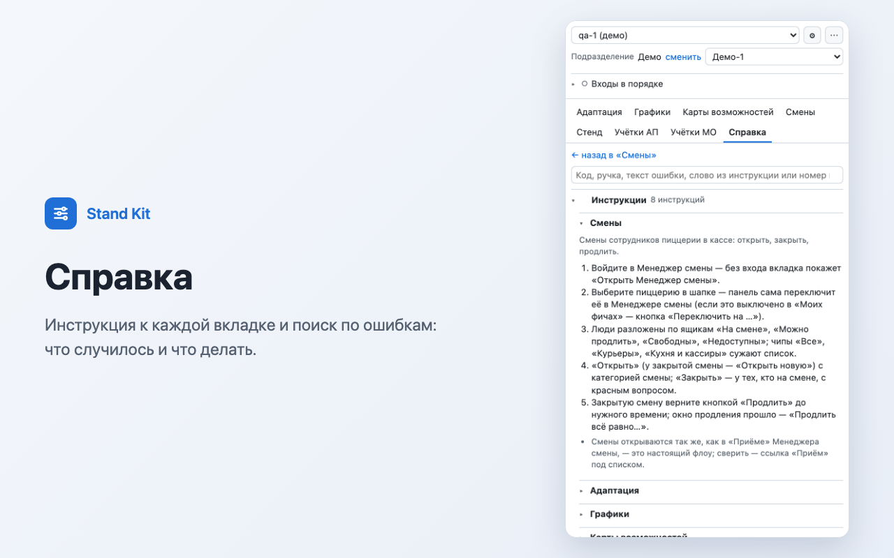
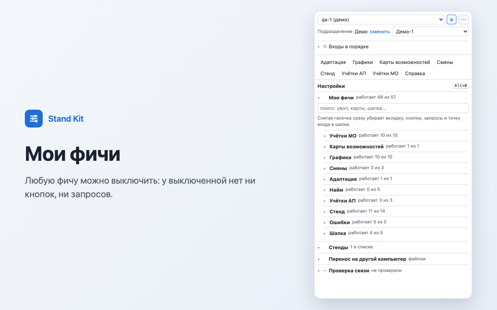

# Stand Kit

Расширение Chrome для команды QA: боковая панель, которая готовит тестовые данные на дев-стенде в пару кликов
и показывает здоровье стенда. Сотрудники с логином и паролем, карты возможностей, графики недели, смены,
учётки с ролями, цели по найму — без ручных запросов, без базы и без отдельных паролей: панель работает под
входами самого тестировщика. Пишет только в дев-стенды.

> Это витрина для портфолио: описание, устройство и картинки на выдуманном стенде «qa-1 (демо)» — имена героев
> мультиков, телефоны +7 900 000-…, придуманные сервисы. Рабочий код живёт в закрытом репозитории команды:
> в нём адреса и ручки внутренних систем.

## Зачем

Чтобы проверить задачу, тестировщику сначала нужны данные: нанять курьера, выдать ему карты на неделю,
рассчитать график, открыть смену, посмотреть, почему упал под. Раньше это — несколько админок, запросы руками,
база и kubectl. В панели — вкладка и кнопка, ошибки объяснены человеческим языком.

## Что умеет

| Вкладка | Что делает |
|---|---|
| Учётки МО | 1–20 тестовых сотрудников формой Менеджера офиса, логин и пароль сразу в панели; сброс пароля, новый телефон, отстранить и вернуть, уволить и восстановить |
| Карты возможностей | Карты на неделю нужному числу людей заданной длины и в заданном окне, двойные карты |
| Графики | Режим автографика по шести режимам, расчёт как на проде, синтетика, пустой график, график кухни, очистить неделю |
| Смены | Открыть, закрыть и продлить смену так же, как это делает Менеджер смены |
| Адаптация | Прогресс курсов обучения выбранным сотрудникам |
| Найм | Цели по найму на месяц: создать план, открыть и закрыть окно |
| Учётки АП | Учётки входа с ролью и областью по готовым рецептам |
| Стенд | Поды, упавшие раскатки, логи, перезапуск, образы, джобы и их расписание, env с маской секретов, рестор |
| Справка | Инструкция к каждой вкладке и поиск по ошибкам: что случилось, почему и что делать |

- Ошибка любого запроса объясняется над журналом: что случилось, что делать, логи за ±2 минуты и кнопка
  «Копировать для бага».
- Любую фичу можно выключить в «Мои фичи»: у выключенной нет ни кнопок, ни запросов.
- Горячие клавиши, светлая и тёмная тема.

## Картинки

| | |
|---|---|
|  |  |
|  |  |
|  |  |

## Как устроено

- **Оболочка — расширение Chrome Manifest V3.** Боковая панель с рамкой и relay запросов: у оболочки есть права
  на домены стендов и куки входов пользователя, поэтому интерфейсу не мешает CORS. Правила declarativeNetRequest
  снимают чужой `Origin` там, где сервис его не пускает. Оболочка меняется редко.
- **Интерфейс — чистый JavaScript без фреймворков,** грузится в рамку с GitHub Pages. Обновления приходят без
  переустановки: открыл панель — уже свежая версия. Логика вынесена в чистые модули без сети и DOM, поэтому
  её легко тестировать.
- **Помощник на Python** — для вкладки «Стенд». Слушает только `127.0.0.1` и только Origin расширения и выполняет
  kubectl правами самого человека. Секретов в расширении нет: env с похожими на секрет значениями приходит маской
  с отпечатком.
- **Реестр фич:** каждая кнопка и запрос описаны в одном месте — отсюда «Мои фичи» и справка.

## Тесты

483 теста на встроенном `node:test` и 70 на `unittest` для помощника, прогон в GitHub Actions на каждый PR.
Тест считается готовым, когда его видели красным: сломать логику — упал, вернуть — зелёный.

## Стек

JavaScript (ES-модули), Chrome Extensions Manifest V3, Python 3, kubectl, GitHub Pages, GitHub Actions,
`node:test`, Playwright — для картинок этой витрины.
